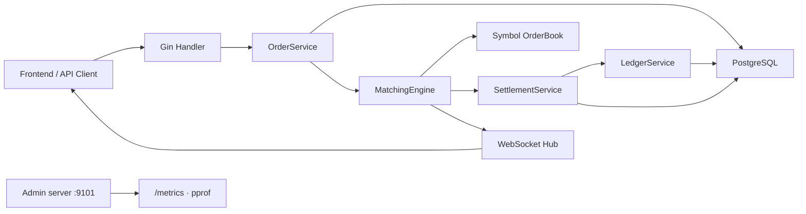
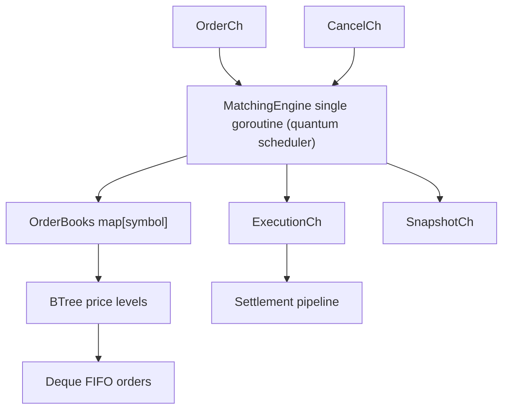
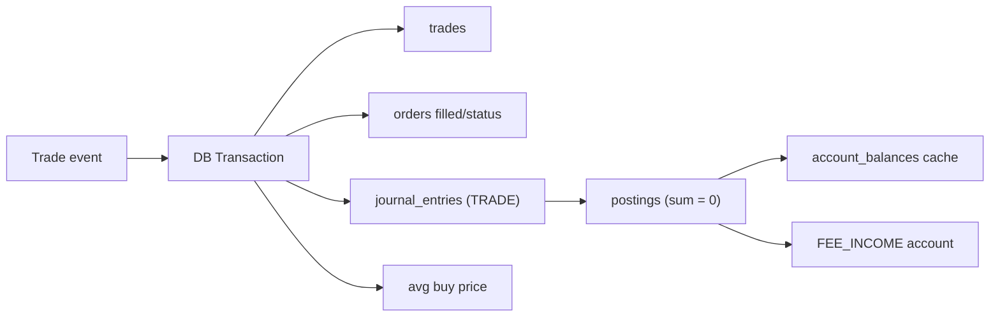

# Go Exchange Backend

Go 기반 실시간 가상자산 거래소 MVP 백엔드입니다.
회원가입과 로그인, 주문 접수, 메모리 매칭엔진, 체결 정산, 복식 부기 원장 기반 잔고 관리, 입출금, 수수료, 평균매수가, WebSocket 실시간 스트림을 하나의 모듈러 모놀리스 구조로 구현했습니다.

이 프로젝트는 실제 입출금이나 외부 보관 지갑을 제공하는 서비스가 아니라, 거래소의 핵심 도메인인 주문, 매칭, 체결, 정산, 잔고 정합성을 학습하고 검증하기 위한 포트폴리오 프로젝트입니다.

## 핵심 기능

| 영역 | 구현 내용 |
| --- | --- |
| 인증 | 회원가입, 로그인, JWT 발급, 인증 미들웨어 |
| 주문 | 지정가/시장가 BUY/SELL, decimal string 기반 가격/수량 처리 |
| 주문 정책 | 코인별 tick size, 수량 step, 주문 타입별 검증 |
| 매칭엔진 | 심볼별 오더북, Price-Time Priority, 부분 체결, 다중 체결 |
| 자료구조 | 가격 레벨은 `google/btree`, 같은 가격대 FIFO는 `gammazero/deque` 사용 |
| 자기 체결 방지 | 동일 사용자 주문끼리 체결되지 않도록 매칭 대상에서 제외 |
| 시장가 주문 | 시장가 매수는 KRW 예산 기준, 시장가 매도는 수량 기준 non-rest 처리 |
| 원장 | 복식 부기 — 모든 잔고 변화는 `journal_entries` + `postings`로 기록하고 자산별 합이 항상 0 |
| 잔고 | 계정 종류로 분리(`USER_AVAILABLE`/`USER_LOCKED`), `account_balances`는 전기 합의 캐시 |
| Hold/Release | 주문 접수 시 available → locked 이체, 취소/미체결 시장가 잔액 반대 방향 이체 |
| 정산 | Trade, Order, Fee, AvgBuyPrice와 원장 전기를 하나의 DB transaction으로 처리 |
| 입출금 | 가짜 은행(BANK)·가짜 체인(CHAIN) rail로 입금/출금, 콜백·폴링 이중 확인 |
| 멱등성 | engine event id, 주문 `Idempotency-Key`, 이체 `client_request_key`, 분개 idempotency key |
| 실패 추적 | 정산 실패 이벤트를 `failed_settlements`에 영속 기록하고 재시도·resolve 가능 |
| 원장 검산 | 분개 불균형·잔고 캐시 drift·자산 총합·음수 계정을 주기적으로 검사하고 위반 기록 |
| 재시작 복구 | 서버 시작 시 DB의 PENDING/PARTIAL 주문을 매칭엔진에 bootstrap |
| 운영 상한 | HTTP 4종 timeout, DB `statement_timeout`·`lock_timeout`(프로필 3종) |
| 요청 상한 | 인증(IP)·주문·이체(사용자) 토큰 버킷 rate limit, `429` + `Retry-After` |
| 관측 | Prometheus 지표를 관리 포트(기본 `127.0.0.1:9101`)로 분리 노출, pprof 선택 활성화 |
| 실시간 스트림 | WebSocket orderbook/trade broadcast, slow client drop, origin whitelist |
| 오더북 초기 동기화 | REST `/orderbook` snapshot과 WebSocket stream을 함께 사용 |
| 마이그레이션 | goose 기반 SQL migration runner |
| 개발 도구 | 로컬 시연용 dev wallet funding API |

자세한 MVP 검증 항목은 [docs/MVP_CHECKLIST.md](docs/MVP_CHECKLIST.md)를 참고하세요.

## 기술 스택

- Go 1.25.7
- Gin 1.12.0
- GORM 1.31.1
- PostgreSQL driver 1.6.0
- jackc/pgx 5.9.2 (DB 프로필별 런타임 파라미터 주입)
- goose 3.27.1
- shopspring/decimal 1.4.0
- google/btree 1.1.3
- gammazero/deque 1.2.1
- Gorilla WebSocket 1.5.3
- prometheus/client_golang 1.23.2
- golang.org/x/crypto 0.50.0
- golang.org/x/time 0.15.0 (rate limit 토큰 버킷)
- testify 1.11.1

## 프로젝트 구조

```text
cmd/                      app bootstrap, routing, goroutine wiring
config/                   DB, env, market rule config
internal/auth/            password hashing, JWT
internal/dbmigration/     goose migration runner
internal/handler/         HTTP handlers
internal/httpapi/         structured response and error helpers
internal/matching/        in-memory matching engine, order book, sharded engine
internal/metrics/         Prometheus collectors
internal/middleware/      auth, rate limit, dev-tool middleware
internal/model/           GORM models
internal/repository/      DB query and transaction helpers
internal/service/         order, settlement, ledger, transfer, market policy services
internal/ws/              WebSocket hub and handler
migrations/               versioned SQL migrations
```

상세 설계는 [docs/ARCHITECTURE.md](docs/ARCHITECTURE.md)를 참고하세요.

## 아키텍처 요약



주문 접수는 DB transaction 안에서 잔고를 먼저 hold한 뒤 주문을 생성하고, transaction 성공 이후 매칭엔진 채널로 전달합니다.
매칭엔진은 심볼별 오더북을 단일 goroutine에서 직렬 처리해 오더북 race를 줄이고, 한 턴에 처리할 매칭 수를 제한하는 quantum 스케줄러로 취소·스냅샷 요청이 굶지 않게 합니다.
체결 이벤트는 `SettlementService`가 DB transaction으로 trade 저장, 주문 fill 누적, 수수료, 평균매수가를 처리하고, 잔고 변화는 모두 `LedgerService`를 통해 복식 부기 전기로 기록합니다.
`/metrics`와 pprof는 서비스 포트가 아니라 별도 관리 서버에서만 제공합니다.

## 매칭엔진

매칭엔진은 심볼별 오더북을 분리해 BTC, ETH, XRP 같은 서로 다른 마켓의 주문이 섞이지 않도록 구성했습니다.

- 가격 레벨 정렬: `google/btree`
- 같은 가격대 시간 우선순위: `gammazero/deque`
- 처리 모델: `OrderCh`, `CancelCh`, `SnapshotCh`를 단일 goroutine에서 직렬 처리
- 지정가 BUY: best ask부터 가격 조건이 맞는 동안 반복 체결
- 지정가 SELL: best bid부터 가격 조건이 맞는 동안 반복 체결
- 시장가 BUY: 예산이 허용하는 범위에서 가능한 호가를 즉시 소진하고 잔액은 release
- 시장가 SELL: 보유 수량을 가능한 호가에 즉시 체결하고 남은 수량은 release
- 자기 체결 방지: 같은 user id의 반대 주문은 체결하지 않음
- 오더북 snapshot: REST `/orderbook`과 WebSocket orderbook 메시지로 제공



### 턴 스케줄링과 방출 용량 예약

한 번의 매칭이 수천 건을 체결할 수 있고 하류(정산 파이프라인)는 그보다 느립니다.
엔진이 하류 채널에 무기한 block되면 그동안 취소도 스냅샷도 처리되지 않으므로, 두 가지 장치를 둡니다.

- **quantum 스케줄러**: 한 턴에 처리할 최대 매칭 수(`GOEXCHANGE_MATCHING_MAX_MATCHES_PER_TURN`, 기본 128)와 연속 취소 처리 한도(`GOEXCHANGE_MATCHING_MAX_CONSECUTIVE_CANCELS`, 기본 8)를 둬 한쪽이 다른 쪽을 굶기지 않게 합니다.
- **방출 용량 예약**: 매칭을 시작하기 전에 그 턴이 만들 실행 이벤트를 `ExecutionCh`에 넣을 자리가 있는지 먼저 확인합니다. 자리가 부족하면 매칭을 시작하지 않고 park 상태로 들어가, 용량이 생기거나 취소 명령이 오면 깨어납니다. 예약한 자리에 넣지 못하는 상황은 계약 위반이므로 panic으로 드러냅니다(재시작 시 outbox replay와 bootstrap이 복구합니다).
- 용량이나 연속 취소 한도가 소진된 상태에서 들어온 취소 명령은 무기한 기다리지 않고 `ErrCancelOrderBackpressured`로 거절됩니다. 이 거절은 HTTP 응답이 아니라 `cancel_commands` worker가 받아 재시도하므로, 사용자에게는 취소 접수(`202`) 계약이 그대로 유지됩니다.
- 심볼 수가 늘어나면 `ShardedEngine`이 심볼을 샤드로 나누고, 샤드별 엔진의 출력을 하나의 `ExecutionCh`로 fan-in 합니다.

## 원장과 정산

잔고는 단일 테이블의 숫자를 더하고 빼는 방식이 아니라 **복식 부기**로 관리합니다.
모든 잔고 변화는 분개(`journal_entries`) 하나와 그에 속한 전기(`postings`) 여러 줄로 기록하고,
한 분개 안에서 **자산별 전기 합은 정확히 0**입니다. 돈이 생기거나 사라지면 분개가 성립하지 않습니다.

| 테이블 | 역할 |
| --- | --- |
| `accounts` | 돈이 담기는 칸. (종류, 소유자, 자산)으로 유일 |
| `postings` | 계정 하나에 대한 한 줄 기록. 들어오면 양수, 나가면 음수 (append-only) |
| `journal_entries` | 사건 하나. `idempotency_key` UNIQUE로 같은 사건의 이중 기록을 DB가 막음 |
| `account_balances` | 전기 합의 **캐시**. 진실은 `postings`이고, 검산이 둘의 일치를 확인 |

계정 종류:

| 종류 | 설명 |
| --- | --- |
| `USER_AVAILABLE` | 사용자가 지금 쓸 수 있는 양 |
| `USER_LOCKED` | 주문이나 출금에 묶인 양 |
| `FEE_INCOME` | 거래소가 받은 수수료 (시스템 계정) |
| `EXTERNAL_BANK` / `EXTERNAL_CHAIN` | 가짜 은행·가짜 체인 바깥 세상 (음수 허용) |
| `DEV_MINT` | 개발용 지급의 출처. 진짜 입금과 섞이지 않게 분리 (음수 허용) |

`EXTERNAL_*`과 `DEV_MINT`가 음수를 허용하는 이유는 바깥에서 들어온 돈의 반대편을 받아 주기 위해서입니다.
사용자가 1,000원을 입금하면 은행 계정은 −1,000이 되고, 시스템 전체 합은 그대로 0입니다.

`LedgerService.Record`가 분개를 만드는 **유일한 경로**입니다 — 검증을 우회해 `postings`에 직접 쓰는 코드를 두지 않습니다.
`Record`는 스스로 트랜잭션을 열지 않고 호출자의 트랜잭션 안에서 실행되므로, 주문 갱신·정산과 같은 커밋 단위에 묶입니다.
정정은 UPDATE·DELETE가 아니라 역분개(`reverses_journal_id`)로만 합니다.

주문 흐름에서의 전기:

- BUY 지정가 주문 접수: KRW `USER_AVAILABLE` → `USER_LOCKED` (`ORDER_HOLD`)
- SELL 지정가 주문 접수: 코인 `USER_AVAILABLE` → `USER_LOCKED` (`ORDER_HOLD`)
- 주문 취소: remaining 기준으로 `USER_LOCKED` → `USER_AVAILABLE` (`ORDER_RELEASE`).
  **`DELETE /orders/:id`는 `202 Accepted`로 "접수"만 응답한다** — 취소 의도를
  `cancel_commands`에 내구 기록한 시점이지 오더북에서 제거된 시점이 아니다. 실제 제거는
  worker가, hold 해제는 정산 파이프라인이 비동기로 수행하므로 최종 상태는 주문 조회로
  확인한다([35번](docs/benchmarks/35-2026-08-23-cancel-command-outbox.md))
- 체결 정산(`TRADE`): 매수자·매도자의 locked 감소, 상대 자산 available 증가, 수수료의 `FEE_INCOME` 이동을 한 분개로 기록하고,
  `trades` 저장·주문 fill 누적·평균매수가 갱신과 같은 DB transaction에 넣습니다.



## 입출금

실제 은행이나 블록체인에 연결하지 않고, **가짜 외부 세계**(`BANK` rail = KRW, `CHAIN` rail = 코인)를 두고
입출금의 상태 전이·멱등성·실패 처리를 구현했습니다. 돈이 바깥을 드나드는 반대편은 `EXTERNAL_BANK`·`EXTERNAL_CHAIN` 계정이 받습니다.

상태: `RECEIVED` → `PROCESSING` → `COMPLETED` 또는 `FAILED` (뒤 둘은 terminal)

- **입금**: 잠글 것이 없으므로 접수는 `RECEIVED`로 끝나고, 외부가 성공을 알려 주면 그때 사용자 잔고가 늘어납니다.
- **출금**: 접수와 **같은 트랜잭션**에서 `USER_AVAILABLE` → `USER_LOCKED` 잠금 분개를 기록합니다.
  키 선점보다 잠금이 먼저면 같은 요청이 두 번 잠기기 때문입니다.
- **제출**: `RECEIVED` 요청만 외부로 제출합니다. 제출 키는 `transfer:{requestID}`로 고정이라, 제출 후 응답 전에 죽어도 재시도가 같은 `external_ref`를 돌려받습니다.
- **결과 확인 이중화**: 외부 콜백(`POST /dev/transfers/callback`)과 상태 폴링(`next_check_at` 기반 백오프) 양쪽으로 확인합니다. 어느 쪽이 먼저 와도 결과는 같습니다.
- **확정과 미확정의 분리**: 확정 결과(`SUCCESS`/`FAILURE`)는 `ResolveTransfer`가, 미확정(`PENDING`/`UNKNOWN`)은 `RecordObservation`이 처리합니다.
  한 함수가 넷을 다 받으면 "미확정인데 확정 분기로 떨어지는" 실수가 가능하고 그 실수는 돈을 움직이므로, 분기가 아니라 **함수를 나눠서** 막습니다.
- **멱등성**: 요청은 `client_request_key`로, 외부 이벤트는 `event_id`로 중복을 거릅니다.

## 복구와 실패 추적

서버가 재시작되면 메모리 오더북은 비어 있으므로, bootstrap 단계에서 DB의 open order를 다시 매칭엔진에 복원합니다.

- 조회 대상: `PENDING`, `PARTIAL`
- 복원 수량: `amount - filled_amount`
- 정렬 기준: `created_at ASC`, `id ASC`
- bootstrap 실패 시 API를 열지 않고 서버 시작을 중단

정산 실패는 로그만 남기지 않고 `failed_settlements`에 기록합니다.
같은 idempotency key의 실패는 row를 계속 늘리지 않고 retry count와 최신 error를 갱신합니다.
운영자 확인 이후 resolve 상태로 전환할 수 있습니다.

실패는 **일시적인 것과 영구적인 것을 구분**합니다. 교착(`40P01`)·직렬화(`40001`)·락 대기 초과(`55P03`)·문장 시간 초과(`57014`)는
일시적 실패로 분류해 재시도 worker가 다시 처리하고, 그 밖의 실패만 사람이 봐야 할 항목으로 남깁니다.
과부하로 재시도가 연달아 시간 초과에 걸리면 그 회차(`RunOnce`)를 중단해 DB를 더 밀어붙이지 않습니다.

### 원장 검산

`ReconciliationWorker`가 주기적으로 원장을 검사하고, 위반을 `reconciliation_violations`에 기록하며 지표로도 노출합니다.

| 검사 | 확인하는 것 |
| --- | --- |
| 분개 불균형 | 한 분개 안에서 자산별 전기 합이 0인가 |
| 잔고 캐시 drift | `account_balances`가 실제 전기 합과 같은가 |
| 자산 총합 | 자산별 전체 합이 0인가(시스템 전체가 닫혀 있는가) |
| 음수 계정 | 음수를 허용하지 않는 계정이 음수가 됐는가 |
| 오래된 시장가 주문 | non-rest여야 할 시장가 주문이 남아 있는가 |

검산은 원장만 봅니다 — 지갑 테이블을 함께 보던 시절처럼 "사라진 수수료"를 따로 더해 맞추는 보정이 필요 없습니다.

## 운영 경계

운영에서 시간·요청·접근 경계를 코드가 아니라 설정으로 조정할 수 있게 열어 두었습니다.
자세한 설계 배경은 [docs/superpowers/specs/2026-09-18-operational-limits-and-auth-hardening-design.md](docs/superpowers/specs/2026-09-18-operational-limits-and-auth-hardening-design.md)에 있습니다.

**HTTP 시간 상한** — `ReadHeaderTimeout`·`ReadTimeout`·`WriteTimeout`·`IdleTimeout`과 `MaxHeaderBytes`를 전부 env로 설정합니다.
느린 헤더·느린 body로 연결을 무한 점유하는 요청이 goroutine을 잡아 두지 못하게 합니다.
WebSocket은 업그레이드 이후 자체 deadline을 쓰므로 전역 `WriteTimeout`의 영향을 받지 않습니다.

**DB 시간 상한** — 용도별로 커넥션 풀을 셋으로 나누고 각각 다른 `statement_timeout`·`lock_timeout`을 겁니다.

| 풀 | statement_timeout | lock_timeout | 용도 |
| --- | --- | --- | --- |
| 마이그레이션 | 10분 | 10초 | 부팅 시 AutoMigrate + goose, 끝나면 닫음 |
| 서비스 | 15초(env) | 3초(env) | API·정산·worker 전체 |
| 검산 | 5분 | 3초 | `ReconciliationWorker` 전용 |

`lock_timeout`은 "정상이면 절대 안 걸리는 값"이 아니라 핫 계정 경합을 의도적으로 잘라내는 값입니다.
부팅 시 세 풀 모두 `SHOW`로 실제 적용값을 확인하고, 하나라도 기대와 다르면 서버를 띄우지 않습니다.

**요청 상한(rate limit)** — `golang.org/x/time/rate` 토큰 버킷. 초과하면 `429` + `Retry-After` + `RATE_LIMITED` 코드입니다.

| 대상 | 키 | 기본 rps | 기본 burst |
| --- | --- | --- | --- |
| `/auth/login`, `/auth/register` (각각 별도 버킷) | 클라이언트 IP | 1 | 10 |
| `POST /orders`, `DELETE /orders/:id` | 사용자 ID | 20 | 40 |
| `POST /transfers/*` | 사용자 ID | 2 | 5 |

클라이언트 IP는 기본적으로 `RemoteAddr`만 믿습니다. 로드밸런서 뒤에 둘 때만 `GOEXCHANGE_TRUSTED_PROXIES`에 CIDR을 넣어야 `X-Forwarded-For`를 반영합니다(설정하지 않으면 헤더 위조로 다른 IP의 버킷을 쓸 수 있습니다).

**관리 포트** — `/metrics`와 pprof는 서비스 포트(`:8080`)가 아니라 관리 서버에서만 제공합니다.
기본 `GOEXCHANGE_ADMIN_ADDR=127.0.0.1:9101`이고, 컨테이너에서는 `0.0.0.0:9101`로 바인드하되 published 하지 않습니다(접근은 SSH 터널).
pprof는 `GOEXCHANGE_ENABLE_PPROF=true`일 때만 등록합니다.

주요 지표 계열:

| 지표 | 보는 것 |
| --- | --- |
| `http_requests_total{method,path,status}` | 요청 수·상태코드 분포(`429` 관측 포함) |
| `goexchange_db_timeout_total{sqlstate,path}` | `55P03`·`57014`가 어느 경로에서 몇 번 발동했는지(시도 단위) |
| `reconciliation_violations`, `reconciliation_last_run_timestamp_seconds` | 원장 검산 위반과 마지막 실행 시각 |
| `matching_engine_quantum_yields_total`, `matching_engine_cancel_backpressured_total` | 턴 양보 횟수, 용량 부족으로 거절된 취소 수 |
| `settlement_outstanding_jobs`, `settlement_quarantined_orders` | 정산 적체와 격리된 주문 |
| `order_idempotency_stale_pending`, `order_idempotency_unknown_total` | 멱등 레코드가 `PENDING`·`UNKNOWN`에 머문 건수 |

**인증** — `GOEXCHANGE_JWT_SECRET`은 필수입니다. 개발용 기본 secret으로 넘어가는 폴백이 없으므로, 설정하지 않으면 서버가 부팅하지 않습니다.

## 실행 방법

PostgreSQL이 실행 중이고 `goexchange` 데이터베이스가 있어야 합니다.

```powershell
createdb -h 127.0.0.1 -p 5432 -U postgres goexchange
```

로컬 설정 파일을 만듭니다.

```powershell
Copy-Item .env.example .env.local
```

예시:

```text
GOEXCHANGE_DB_PASSWORD=<local-postgres-password>
GOEXCHANGE_MARKET_RULES_PATH=config/market_rules.json
GOEXCHANGE_ENABLE_DEV_TOOLS=true
GOEXCHANGE_DEV_TOOLS_TOKEN=<local-dev-tools-token>
GOEXCHANGE_ENABLE_UPBIT=false
GOEXCHANGE_CORS_ALLOWED_ORIGINS=http://localhost:3000,http://127.0.0.1:3000
GOEXCHANGE_WS_ALLOWED_ORIGINS=http://localhost:3000,http://127.0.0.1:3000
GOEXCHANGE_JWT_SECRET=<local-jwt-secret>
GOEXCHANGE_AUTH_RATE_LIMIT_RPS=400
GOEXCHANGE_AUTH_RATE_LIMIT_BURST=200
```

`GOEXCHANGE_JWT_SECRET`은 필수입니다 — 없으면 서버가 부팅하지 않습니다.
인증 rate limit 값은 로컬 개발·E2E용으로 넉넉하게 잡은 것이며 운영 값이 아닙니다(기본값은 `1rps/burst 10`, [TESTING.md](TESTING.md) 참고).

서버 실행:

```powershell
go run ./cmd
```

서버 시작 시 전용 마이그레이션 풀로 GORM AutoMigrate 이후 goose migration을 적용하고, 그 풀을 닫은 뒤 서비스 풀로 전환합니다.
정상 기동 후 `/ping`, `/auth/*`, `/orders`, `/wallets`, `/trades`, `/transfers`, `/markets/rules`, `/orderbook`, `/ws`를 사용할 수 있습니다.
지표와 프로파일은 서비스 포트가 아니라 관리 포트에 있습니다 — 기본값 기준 `http://127.0.0.1:9101/metrics`.

## API 요약

| Method | Path | 인증 | 설명 |
| --- | --- | --- | --- |
| GET | `/ping` | 없음 | 헬스 체크 |
| POST | `/auth/register` | 없음 | 사용자 생성, JWT 반환 |
| POST | `/auth/login` | 없음 | 로그인, JWT 반환 |
| GET | `/markets/rules?coin_symbol=BTC` | 없음 | 시장 정책 조회 |
| GET | `/orderbook?coin_symbol=BTC` | 없음 | 현재 오더북 snapshot 조회 |
| POST | `/orders` | 필요 + `Idempotency-Key` | 지정가/시장가 주문 생성 |
| DELETE | `/orders/:id` | 필요 | 미체결/부분체결 주문 **취소 command 접수**(`202 Accepted`) |
| GET | `/orders` | 필요 | 내 주문 목록 |
| GET | `/orders/:id` | 필요 | 내 주문 단건 |
| GET | `/wallets` | 필요 | 내 자산별 available/locked 잔고 |
| GET | `/trades` | 필요 | 내 체결 목록 |
| POST | `/transfers/deposits` | 필요 + `client_request_key` | 입금 요청 접수 |
| POST | `/transfers/withdrawals` | 필요 + `client_request_key` | 출금 요청 접수(접수와 같은 트랜잭션에서 잠금) |
| GET | `/transfers` | 필요 | 내 입출금 요청 목록 |
| POST | `/dev/wallets/fund` | 필요 + dev token | 로컬 개발용 지갑 충전 |
| POST | `/dev/transfers/callback` | 필요 + dev token | 가짜 은행·체인의 결과 통보(시연용) |
| GET | `/ws` | origin whitelist | orderbook/trade stream |

금액과 수량은 JSON decimal string으로 주고받습니다.

`/metrics`는 이 목록에 없습니다 — 서비스 포트가 아니라 관리 포트(기본 `127.0.0.1:9101`)에서만 제공합니다.

### 요청 상한 응답

인증·주문·이체 경로는 rate limit 대상입니다. 초과하면 다음과 같이 응답합니다.

```json
{ "error": { "code": "RATE_LIMITED", "message": "rate limit exceeded, retry later" } }
```

`429`와 함께 `Retry-After`(초, 최소 1)를 보냅니다.
**`429`는 서버가 요청을 판정한 것이 아니라 처리하지 않고 거절한 것이므로, 클라이언트는 멱등키를 버리지 않고 같은 키로 재시도해야 합니다.**

### 주문 생성의 멱등성 계약

`POST /orders`는 `Idempotency-Key` 헤더를 **필수로 요구**합니다(1~128자, 공백만이면 거부).
응답을 받지 못한 재시도가 중복 주문과 중복 hold를 만드는 것을 막기 위해서입니다.

- 키는 사용자 단위로 유일합니다(`(user_id, idempotency_key)` UNIQUE).
- **같은 키 + 같은 주문 내용**은 저장된 결과를 그대로 돌려줍니다(새 주문을 만들지 않습니다).
- **같은 키 + 다른 주문 내용**은 `409 Conflict`입니다.

키 형식 오류는 **어디서 걸리느냐에 따라 상태코드가 다릅니다.**

| 입력 | HTTP | 걸리는 곳 |
|---|---|---|
| 헤더 없음, 또는 공백만 | **400** | 핸들러의 사전 검사 |
| 공백이 아니면서 129자 이상 | **422** | 서비스 validation(`ErrorKindValidation`) |

응답은 서버가 **durable하게 아는 상태**를 반영합니다. 다만 **같은 `PENDING`이라도 최초 요청과
저장된 결과의 재요청은 상태코드가 다릅니다** — 최초 요청은 "방금 실패했다"를, 재요청은
"저장된 상태가 이렇다"를 말하기 때문입니다.

| 상황 | durable outcome | HTTP | 응답 본문 |
|---|---|---|---|
| 엔진이 접수 | `ACCEPTED` | **200** | `order_id` (+재요청이면 `idempotent_replay`) |
| 저장된 `PENDING`의 재요청, 또는 같은 배치의 중복 요청 | `PENDING` | **202** | `order_id` · `status` · `idempotent_replay` |
| 최초 요청에서 보상 성공(hold 해제·주문 `REJECTED`) | `REJECTED` | **503** | `order_id` · `status:"REJECTED"` |
| 최초 요청에서 보상 실패, `UNKNOWN` 기록 성공 | `UNKNOWN` | **503** | `order_id` · `status:"UNKNOWN"` |
| 최초 요청에서 보상 실패, `UNKNOWN` 기록**도** 실패 | `PENDING` | **503** | `order_id` · `status:"PENDING"` |
| 저장된 `REJECTED`·`UNKNOWN`의 재요청 | 그대로 | **503** | `order_id` · `status` |

마지막에서 두 번째 줄이 핵심입니다. **DB가 `PENDING`이라고 해서 항상 `202`가 아닙니다** —
최초 요청에서 되돌리기까지 실패해 `PENDING`에 머문 경우는 `503 + order_id`입니다.
서버가 "진행 중"이라고 말할 수 없는 상태이기 때문입니다.

`202`·`503` 응답도 `order_id`를 함께 줍니다 — 사용자가 그 주문을 조회할 수 있어야 하기 때문입니다.
**`PENDING`·`UNKNOWN`은 같은 키로 재시도해도 같은 상태가 돌아옵니다.** 재시도가 해결 수단이
아니므로 주문 상태를 먼저 조회해야 합니다.

클라이언트는 **한 번의 주문 시도마다 키를 하나** 만들고, 응답을 받지 못한 재시도에는 **같은 키**를
씁니다. 주문 내용이 바뀌거나 서버 응답이 도착하면 그 시도는 끝난 것이므로 다음 제출에는 새 키를
씁니다.

관측 지표: `order_idempotency_stale_pending`(gauge), `order_idempotency_unknown_total`,
`order_idempotency_outcome_update_failures_total`, `order_idempotency_monitor_errors_total`.
`PENDING`은 프로세스가 hold 커밋 직후 죽으면 어떤 counter도 오르지 않으므로 gauge로 관측합니다.

## 테스트

기본 테스트:

```powershell
go test ./...
go vet ./...
go test -count=20 ./internal/matching
```

PostgreSQL 통합 테스트는 `GOEXCHANGE_TEST_DATABASE_DSN`이 있을 때 실제 DB에 연결합니다.

```powershell
docker compose -f docker-compose.test.yml up -d
$env:GOEXCHANGE_TEST_DATABASE_DSN="host=localhost user=goexchange_test password=goexchange_test_password dbname=goexchange_test port=55432 sslmode=disable"
go test -run Integration -v ./internal/repository ./internal/service
docker compose -f docker-compose.test.yml down -v
```

자세한 테스트 환경은 [TESTING.md](TESTING.md)를 참고하세요.

## 로컬 시연 흐름

1. 백엔드 `.env.local`에서 `GOEXCHANGE_ENABLE_DEV_TOOLS=true`와 `GOEXCHANGE_DEV_TOOLS_TOKEN`을 설정합니다.
2. 백엔드를 `go run ./cmd`로 실행합니다.
3. 프론트엔드를 `npm run dev`로 실행합니다.
4. 계정 A/B를 만들고, A에는 코인, B에는 KRW를 충전합니다.
5. A가 지정가 매도 주문을 올리고, B가 지정가 또는 시장가 매수로 체결합니다.
6. 주문 상태, 자산별 available/locked, 수수료, 평균매수가, 체결 내역, 오더북 갱신을 확인합니다.
7. 입출금을 시연하려면 `/transfers/deposits`·`/transfers/withdrawals`로 요청하고, 가짜 외부의 결과 통보는 `/dev/transfers/callback`으로 보냅니다(폴링으로도 같은 결과에 도달합니다).
8. 서버 재시작 후 open order bootstrap 복원 흐름을 확인합니다.

상세 시연 절차는 [docs/DEMO_SCENARIO.md](docs/DEMO_SCENARIO.md)를 참고하세요.
