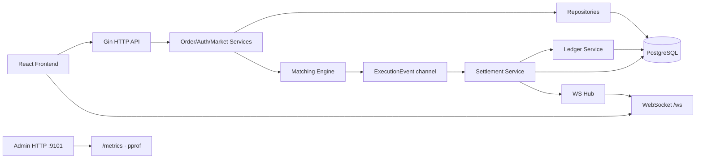
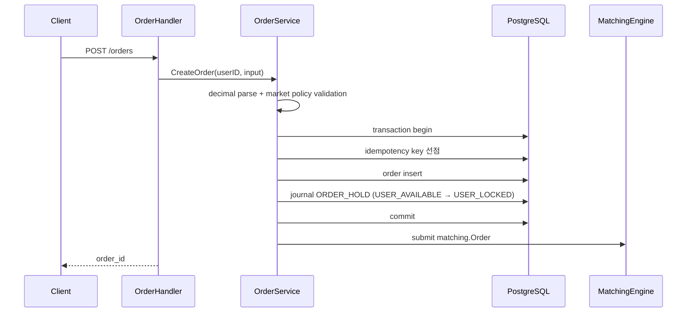
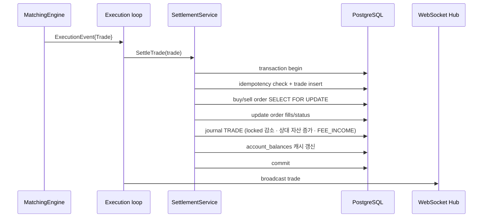
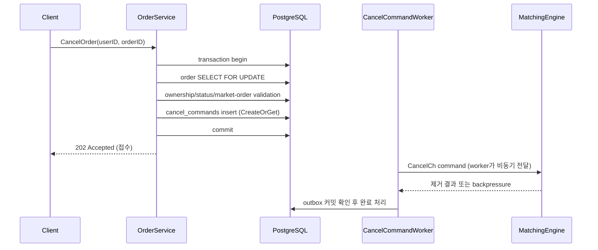

# Architecture

Go Exchange Backend는 모듈러 모놀리스 구조입니다. 프로세스는 하나지만 handler, service, repository, matching, ws, auth, migration 책임을 분리했습니다.

## 전체 흐름



서비스 포트(`:8080`)는 사용자 API와 WebSocket만 제공하고, 지표와 프로파일은 별도 관리 서버가 담당합니다.

## 레이어 역할

| 레이어 | 역할 |
| --- | --- |
| `cmd/main.go` | 설정 로드, DB 풀 3종, migration, service wiring, goroutine 시작, 서비스·관리 HTTP 서버, 종료 순서 |
| `cmd/router.go` | 서비스 라우트와 미들웨어 배선(테스트가 실제 라우터를 그대로 검증할 수 있도록 분리) |
| `config` | DB 프로필·DSN, env file, runtime flag, HTTP·rate limit 설정 파싱 |
| `handler` | HTTP request binding, auth user 추출, response/error 매핑 |
| `middleware` | 인증, rate limit, dev-tools 보호 |
| `service` | 주문 정책, hold/release, 정산, 원장, 입출금, market rules, failed settlement, 검산 |
| `repository` | GORM query, row lock, transaction scope |
| `matching` | 순수 인메모리 오더북, 턴 스케줄링, 체결 이벤트 생성 |
| `metrics` | Prometheus collector 정의 |
| `ws` | WebSocket client 관리와 broadcast |
| `model` | GORM table model |
| `migrations` | goose SQL migration |

## 매칭엔진

매칭엔진은 단일 goroutine + channel로 직렬화됩니다.

```text
OrderCh / CancelCh
        |
        v
MatchingEngine.Start goroutine
        |
        +--> symbol별 OrderBook
        +--> ExecutionEventCh
        +--> SnapshotCh
```

자료구조:

- `map[string]*OrderBook`: 코인 심볼별 오더북 분리
- `btree.BTree`: 가격 레벨 정렬
- `deque.Deque`: 같은 가격 안에서 FIFO 주문 큐
- best ask: sell tree의 `Min`
- best bid: buy tree의 `Max`

지원 정책:

- 지정가 매수는 `best ask <= buy price` 동안 반복 체결
- 지정가 매도는 `best bid >= sell price` 동안 반복 체결
- 시장가 매수는 quote budget 안에서 가능한 ask를 소비하고 남은 예산은 rest하지 않음
- 시장가 매도는 수량 안에서 가능한 bid를 소비하고 남은 수량은 rest하지 않음
- 같은 사용자 주문은 self-trade 방지를 위해 건너뜀
- 남은 지정가 수량은 오더북에 rest
- 완전히 비워진 가격 레벨은 제거
- snapshot은 depth 제한을 적용해 broadcast

턴 스케줄링과 하류 보호:

- 한 턴에 처리할 매칭 수(`maxMatchesPerTurn`, 기본 128)와 연속 취소 처리 한도(`maxConsecutiveCancels`, 기본 8)를 둬 주문·취소·스냅샷이 서로를 굶기지 않게 합니다.
- 매칭을 시작하기 전에 그 턴이 만들 실행 이벤트가 `ExecutionCh`에 들어갈 자리가 있는지 먼저 확인합니다(방출 용량 예약). 자리가 없으면 매칭을 시작하지 않고 park하며, 용량이 생기거나 취소가 오면 깨어납니다 — 하류가 막혀도 엔진이 무기한 block되지 않습니다.
- 용량이나 연속 취소 한도가 소진된 상태의 취소 명령은 `ErrCancelOrderBackpressured`로 즉시 거절되고, `cancel_commands` worker가 재시도합니다.
- 심볼이 늘어나면 `ShardedEngine`이 심볼을 샤드로 나누고 샤드별 출력을 하나의 실행 채널로 fan-in 합니다.

## 주문 생성



중요한 점:

- DB transaction이 성공한 뒤에만 엔진에 주문을 넣습니다.
- 주문 생성 중 hold 분개가 실패하면 order row와 engine submit이 생기지 않습니다.
- `Idempotency-Key`가 필수이고, 같은 키의 재요청은 저장된 결과를 돌려줍니다(README의 멱등성 계약 표 참고).
- 시장가 매수는 `quote_amount`, 시장가 매도는 `amount`를 기준으로 hold합니다.

## 체결/정산



정산 불변식:

- `PENDING`, `PARTIAL` 주문만 정산 가능
- 이미 정산된 idempotency key는 주문·원장을 다시 변경하지 않음
- 한 분개 안에서 자산별 전기 합은 0 — 수수료도 사라지지 않고 `FEE_INCOME`이 받음
- 같은 key인데 payload가 다르면 conflict
- buyer fee와 seller fee는 KRW로 부과
- buyer coin은 체결 수량 그대로 증가
- seller KRW는 체결대금에서 seller fee를 뺀 금액만 증가

## 주문 취소



취소는 **접수와 수행이 분리**돼 있습니다.

- HTTP 응답 `202`는 취소 의도를 `cancel_commands`에 내구 기록했다는 뜻이지, 오더북에서 제거됐다는 뜻이 아닙니다.
- `CancelCommandWorker`가 명령을 엔진에 전달하고, 엔진의 성공 반환만으로 완료 처리하지 않고 outbox 커밋을 DB에서 확인할 때까지 붙잡습니다.
- 엔진이 `ErrCancelOrderBackpressured`를 돌려주면 worker가 재시도합니다. 사용자에게 노출되는 계약은 바뀌지 않습니다.
- hold 해제는 정산 파이프라인이 수행하므로, 최종 상태는 주문 조회로 확인합니다.

한계:

- DB cancel과 engine cancel은 완전한 단일 원자 경계가 아닙니다.
- stale trade가 늦게 들어오면 settlement status guard가 거부하고 failed_settlements에 기록합니다.

## 재시작 복구

서버 시작 시 DB의 open order를 matching engine에 복원합니다.

조건:

- `status IN (PENDING, PARTIAL)`
- `amount > filled_amount`
- `created_at ASC, id ASC`

부분 체결 주문은 `amount - filled_amount`만 복원합니다. bootstrap 실패 시 API를 열지 않고 서버를 종료합니다.

## 원장

잔고는 복식 부기로 관리합니다. 과거의 `wallets`·`ledger_entries`(잔고 테이블 + 변화 로그) 구조는 migration 010에서 제거됐습니다.

| 테이블 | 역할 |
| --- | --- |
| `accounts` | (종류, 소유자, 자산)으로 유일한 계정 |
| `journal_entries` | 사건 하나. `idempotency_key` UNIQUE, UPDATE·DELETE 없음(정정은 역분개) |
| `postings` | 계정별 변화량. append-only, 금액 0 금지 |
| `account_balances` | 전기 합의 캐시(`last_posting_id`로 어디까지 반영했는지 기록) |

계정 종류는 `USER_AVAILABLE`, `USER_LOCKED`, `FEE_INCOME`, `EXTERNAL_BANK`, `EXTERNAL_CHAIN`, `DEV_MINT`입니다.
뒤의 셋은 음수 잔액을 허용합니다 — 바깥에서 들어온 돈의 반대편을 받아야 시스템 전체 합이 0으로 닫히기 때문입니다.

| event_type | 발생 시점 |
| --- | --- |
| `DEV_FUND` | 개발용 충전 (`DEV_MINT` → 사용자) |
| `ORDER_HOLD` | 주문 생성 (`USER_AVAILABLE` → `USER_LOCKED`) |
| `ORDER_RELEASE` | 주문 취소·시장가 미체결 (`USER_LOCKED` → `USER_AVAILABLE`) |
| `TRADE` | 체결 정산 (양쪽 자산 이동 + `FEE_INCOME`) |
| `DEPOSIT` / `WITHDRAWAL` | 입출금 (`EXTERNAL_BANK`·`EXTERNAL_CHAIN` ↔ 사용자) |
| `REVERSAL` | 역분개 |

`LedgerService.Record`가 분개를 만드는 유일한 경로입니다. 호출자의 트랜잭션 안에서 실행되며,
멱등 판정을 잔액 검사보다 **먼저** 합니다 — 반대로 두면 이미 처리된 요청의 재관측이 현재 잔액 때문에 실패하고, 외부가 알림을 계속 재전송하는 고리에 들어갑니다.

`ReconciliationWorker`가 분개 불균형·잔고 캐시 drift·자산 총합·음수 계정·오래된 시장가 주문을 주기적으로 검사해
`reconciliation_violations`에 기록하고 지표로 노출합니다.

## WebSocket

- `/ws`에서 orderbook/trade 메시지를 broadcast
- origin whitelist 적용
- readPump/writePump로 연결 종료 감지
- ping/pong deadline 적용
- 느린 client의 send buffer가 가득 차면 해당 client를 제거

## 실패 정산

matching engine이 trade를 만들었지만 settlement가 거부하면 `failed_settlements`에 남깁니다.

예:

- 취소된 주문에 대한 stale trade
- idempotency conflict
- locked balance 부족

실패는 일시적인 것과 영구적인 것으로 나눕니다.
교착(`40P01`)·직렬화(`40001`)·락 대기 초과(`55P03`)·문장 시간 초과(`57014`)는 일시적 실패로 분류돼
`SettlementRetryWorker`가 다시 처리하고, 나머지만 operator investigation log로 남습니다.
과부하로 재시도가 연달아 시간 초과에 걸리면 그 회차를 중단해 DB를 더 밀어붙이지 않습니다.

## 입출금

가짜 외부 세계(`BANK` rail = KRW, `CHAIN` rail = 코인)를 두고 상태 전이와 멱등성을 구현했습니다.
상태는 `RECEIVED` → `PROCESSING` → `COMPLETED`/`FAILED`입니다.

- 출금은 접수와 **같은 트랜잭션**에서 잠금 분개를 남깁니다(키 선점보다 잠금이 먼저면 같은 요청이 두 번 잠깁니다).
- 외부 제출 키는 `transfer:{requestID}`로 고정이라 제출 후 응답 전에 죽어도 같은 `external_ref`를 다시 받습니다.
- 결과는 콜백과 폴링 양쪽으로 확인하며, 확정 결과(`SUCCESS`/`FAILURE`)는 `ResolveTransfer`가, 미확정(`PENDING`/`UNKNOWN`)은 `RecordObservation`이 처리합니다 — 분기가 아니라 함수를 나눠 "미확정인데 돈을 움직이는" 실수를 막습니다.

## 운영 경계

- 서비스 `http.Server`에 4종 timeout과 `MaxHeaderBytes`를 적용합니다(전부 env).
- DB 커넥션 풀을 마이그레이션(10분/10초)·서비스(15초/3초)·검산(5분/3초)으로 나누고, 부팅 시 `SHOW`로 실제 적용값을 검증합니다.
- 인증(IP)·주문·이체(사용자)에 토큰 버킷 rate limit을 두고 초과 시 `429` + `Retry-After`를 반환합니다. 프록시 신뢰 CIDR을 설정하지 않으면 `X-Forwarded-For`를 믿지 않습니다.
- `/metrics`·pprof는 관리 서버(`GOEXCHANGE_ADMIN_ADDR`, 기본 `127.0.0.1:9101`)에서만 제공합니다.
- 종료는 서비스·관리 서버가 예산을 공유하지 않고, 서비스 Shutdown이 실패하면 파이프라인을 닫지 않고 프로세스를 종료합니다 — 반쯤 닫는 것보다 다음 부팅의 replay·bootstrap에 맡기는 편이 안전합니다.

## 남은 구조적 과제

- DB pool 획득 상한(서비스·리포지토리가 `ctx`를 받지 않아 전 계층 배선이 필요)
- terminal outbox 원자성
- refresh token과 계정 잠금
- SLO·알림·구조화 로그와 분산 추적
- 매칭 샤드 fan-in 격리와 `FEE_INCOME` 계정 경합 측정
- production deployment topology
